# Cybersecurity-Operations-and-Reconnaissance-Labs
A hands-on cybersecurity portfolio documenting security assessments, web footprinting, OSINT investigations, network reconnaissance, vulnerability analysis, and defensive security practices, with practical demonstrations, technical findings, evidence, and recommendations.
# 🔐 WEEK 2 SECURITY ASSESSMENT REPORT

## Reconnaissance, OSINT and Network Discovery

**W2-PM-FINAL | NETWORKWALKS CYBERSECURITY & ETHICAL HACKING INTERNSHIP**

| Item                                     | Detail                                                                                                                           |
| ---------------------------------------- | -------------------------------------------------------------------------------------------------------------------------------- |
| **Prepared by**                          | Nwadobu Chiemlie Fredrick                                                                                                        |
| **Internship batch**                     | B084 – Networkwalks                                                                                                              |
| **Report date**                          | 13 November 2026                                                                                                                 |
| **Environment**                          | Kali Linux in Oracle VirtualBox (host: Windows 10); Maltego Graph Desktop 4.11.3 (Windows 10)                                    |
| **Official practical modules completed** | W2-PM1, W2-PM4 and W2-PM5                                                                                                        |
| **Additional exercises completed**       | GHDB research and Maltego visual OSINT                                                                                           |
| **Targets**                              | `networkwalks.com` (lab-assigned); `microsoft.com` (public-source OSINT); personally owned home Wi-Fi network                    |
| **Assessment stage**                     | Information gathering, reconnaissance, scanning and host discovery. Exploitation and later assessment stages were not performed. |

---

## 1. Liability Disclaimer and Assessment Scope

All activities documented in this report were conducted for educational purposes within the Networkwalks cybersecurity internship.

The web domain used for footprinting and Maltego investigation was assigned as a laboratory target. TheHarvester exercise involved collecting information from public sources about `microsoft.com`; the tool was not used to conduct direct exploitation or unauthorised testing of Microsoft's systems. Network discovery was performed only on a personally owned Wi-Fi network.

GHDB searches were limited to identifying publicly indexed references. Third-party camera interfaces were not accessed, credentials were not tested, and private camera feeds were not viewed.

The findings presented are reconnaissance observations and tool-generated results. They do not establish that the assessed organisation or any third-party system was compromised.

No exploitation, authentication bypass, password testing, vulnerability exploitation or unauthorised access is claimed.

This report distinguishes between:

- **Observed evidence:** information directly returned by a tool or search.
- **Interpretation:** what the observation may mean from a security perspective.
- **Potential exposure:** an item that may warrant further investigation.
- **Confirmed vulnerability:** a weakness demonstrated through sufficient authorised testing.

The assessment did not establish any confirmed exploitable vulnerability.

---

## 2. Executive Summary

This report documents the technical activities, observations, procedures, challenges and lessons learned during Week 2 of the Networkwalks Cybersecurity & Ethical Hacking Internship.

The week's work focused on reconnaissance, Open-Source Intelligence (OSINT), web footprinting, search-engine intelligence, visual intelligence analysis and network discovery.

The work covered three official practical modules and two additional exercises undertaken to strengthen practical knowledge and experience.

### 2.1 Practical activities

**1. W2-PM1: Web Footprinting and Reconnaissance**

Performed against `networkwalks.com` using six Kali Linux utilities:

- WHOIS — domain registration information.
- WhatWeb — website technology fingerprinting.
- Nslookup — DNS resolution.
- cURL — HTTP response-header inspection.
- WAFW00F — web application firewall identification.
- DNSRecon — DNS enumeration.

The exercise provided insight into domain registration, publicly observable web technologies, DNS records, HTTP response configuration and defensive technology indicators.

**2. Additional Exercise A: Google Hacking Database (GHDB) Research**

Used specialised Google search operators to identify publicly indexed webcam-related pages and a mathematics PDF directory candidate.

Seven webcam-related examples and one mathematics directory candidate were recorded. The exercise demonstrated how search-engine indexing can reveal information about publicly accessible resources. Search results were treated as leads, not proof of vulnerabilities.

**3. Additional Exercise B: Maltego Visual OSINT Investigation**

Used Maltego Graph Desktop 4.11.3 to investigate the lab-assigned domain `networkwalks.com`.

Three email-discovery transforms were executed. The resulting graph contained two entities and one relationship: the domain and the public contact address `info@networkwalks.com`.

The same email address was independently reported by WhatWeb during PM1. This provided corroboration from a second tool.

**4. W2-PM4: Open-Source Intelligence with theHarvester**

Used theHarvester v4.10.1 against `microsoft.com` through public information sources.

Two executions were performed:

- Baidu source search with a requested limit of 1,000.
- All-source search with a requested limit of 50.

The Baidu execution returned no IP addresses, emails, people or hosts. The all-source execution returned numerous subdomains and some associated IP addresses, including hostnames containing staging, QA, beta and pre-production naming patterns.

Some integrations were unavailable because API keys were not configured.

**5. W2-PM5: Network Discovery with Zenmap/Nmap**

Performed host discovery on a personally owned Wi-Fi network using Zenmap and Nmap.

The scan targeted `192.168.61.0/24` and identified two responsive hosts:

- `192.168.61.230` — default gateway.
- `192.168.61.164` — local computer.

The network topology was exported as `zenmap_topology.pdf`.

### 2.2 Overall outcome

The exercises provided practical exposure to five areas of reconnaissance and discovery:

1. Domain and web infrastructure investigation.
2. Search-engine-based information discovery.
3. Visual OSINT and relationship analysis.
4. Public-source domain intelligence collection.
5. Internal network host discovery.

The work also highlighted the importance of verifying tool output, documenting limitations and distinguishing ordinary infrastructure information from actual security weaknesses.

---

## 3. Introduction

### 3.1 Background

Reconnaissance is an important early stage of cybersecurity assessment. Before evaluating a system's security, an analyst needs to understand what information is observable about its digital environment.

This may include:

- Domain registration information.
- DNS configuration and public IP addresses.
- Web servers, CMS platforms and technology indicators.
- Publicly indexed documents and webpages.
- Public email addresses and subdomains.
- Devices responding within an authorised network.

Different reconnaissance tools provide different perspectives. Some collect information from public sources, while others query network services or identify responsive hosts within an approved network.

The practical activities in this report demonstrate these different approaches, beginning with public information gathering and progressing to host discovery on a personally controlled network.

### 3.2 Objectives

The objectives were to:

1. Understand domain and website footprinting.
2. Retrieve and interpret WHOIS, DNS and HTTP information.
3. Identify observable web technologies and possible WAF indicators.
4. Apply advanced Google search operators to discover indexed resources.
5. Understand Maltego entities, transforms and relationship graphs.
6. Collect publicly available domain intelligence using theHarvester.
7. Perform host discovery using Zenmap/Nmap on an authorised network.
8. Interpret technical results without automatically classifying observations as vulnerabilities.
9. Document commands, evidence, limitations and recommendations.

### 3.3 Methodology

| Phase                             | Activities                                                                                   |
| --------------------------------- | -------------------------------------------------------------------------------------------- |
| **1. Preparation**                | Prepared Kali Linux in VirtualBox, selected the tools and confirmed assessment scope.        |
| **2. Web reconnaissance**         | Used WHOIS, WhatWeb, Nslookup, cURL, WAFW00F and DNSRecon.                                   |
| **3. Search-engine intelligence** | Used GHDB queries and advanced Google search operators to identify indexed resources.        |
| **4. Visual OSINT**               | Created a Maltego graph and executed email-discovery transforms.                             |
| **5. Public-source enumeration**  | Used theHarvester to collect domain-related information from supported public sources.       |
| **6. Network discovery**          | Identified the local subnet and performed an Nmap host-discovery scan through Zenmap.        |
| **7. Analysis and documentation** | Reviewed outputs, compared observations, recorded limitations and developed recommendations. |

Kali Linux activities were performed inside Oracle VirtualBox on Windows 10. Maltego was run separately on the Windows host. The local network discovery exercise was also performed from Windows.

---

## 4. Tools and Technologies

| Tool / Technology            | Category                           | Purpose                                                                                                  |
| ---------------------------- | ---------------------------------- | -------------------------------------------------------------------------------------------------------- |
| Kali Linux                   | Operating system                   | Cybersecurity environment for reconnaissance and information gathering.                                  |
| Oracle VirtualBox            | Virtualisation                     | Used to run Kali Linux in a virtual machine.                                                             |
| WHOIS                        | Domain intelligence                | Retrieves public domain registration and nameserver information.                                         |
| WhatWeb                      | Web reconnaissance                 | Identifies observable web technologies, CMS indicators and related components.                           |
| Nslookup                     | DNS analysis                       | Resolves domain names and retrieves DNS information.                                                     |
| cURL                         | HTTP analysis                      | Retrieves HTTP response information and headers.                                                         |
| WAFW00F                      | Security technology identification | Identifies possible web application firewall technologies.                                               |
| DNSRecon                     | DNS enumeration                    | Collects DNS records and examines DNS configuration.                                                     |
| Google Hacking Database      | Search-engine intelligence         | Provides specialised search queries for discovering indexed information.                                 |
| Google Search Operators      | OSINT                              | Narrows search results using operators such as `site:`, `filetype:`, `intitle:`, `inurl:` and `intext:`. |
| Maltego Graph Desktop 4.11.3 | Visual OSINT                       | Uses entities, transforms and graphs to identify relationships between digital assets.                   |
| theHarvester v4.10.1         | OSINT enumeration                  | Collects public emails, subdomains, hostnames and associated IP information from supported sources.      |
| Nmap                         | Network discovery                  | Performs host discovery and network scanning.                                                            |
| Zenmap                       | Network scanning interface         | Provides a graphical interface for configuring Nmap scans and reviewing results.                         |
| Windows Command Prompt       | Network administration             | Retrieves local IP configuration, subnet and MAC address information.                                    |
| ShareX                       | Evidence collection                | Captures screenshots of practical activities.                                                            |

### 4.1 Tool Categories

- **Web footprinting:** WHOIS, WhatWeb, Nslookup, cURL, WAFW00F and DNSRecon.
- **Search-engine intelligence:** GHDB and Google Search Operators.
- **Visual OSINT:** Maltego.
- **Public-source enumeration:** theHarvester.
- **Network discovery:** Nmap, Zenmap and Windows Command Prompt.

---

## 5. Activities Performed

### 5.1 W2-PM1: Web Footprinting and Reconnaissance

| Item                | Detail                                                                        |
| ------------------- | ----------------------------------------------------------------------------- |
| **Target**          | `networkwalks.com`                                                            |
| **Environment**     | Kali Linux                                                                    |
| **Assessment type** | Passive and low-impact web reconnaissance                                     |
| **Objective**       | Collect publicly observable domain, web technology, DNS and HTTP information. |

Six tools were used to examine different aspects of the target's external digital footprint.

#### 5.1.1 WHOIS: Domain Registration Information

**Command:**
```
whois networkwalks.com
```

**Purpose**

WHOIS retrieves publicly available domain registration information, including registrar details, registration dates, nameservers and domain status.

**Results obtained**

| Information                                  | Observed result                                    |
| -------------------------------------------- | -------------------------------------------------- |
| Domain name                                  | `networkwalks.com`                                 |
| Registry Domain ID                           | `2452319255_DOMAIN_COM-VRSN`                       |
| Registrar                                    | GoDaddy.com, LLC                                   |
| IANA ID                                      | 146                                                |
| WHOIS server                                 | `whois.godaddy.com`                                |
| Creation date                                | 6 November 2019                                    |
| Last updated                                 | 12 November 2025                                   |
| Expiry date                                  | 6 November 2027                                    |
| DNSSEC status                                | Unsigned                                           |
| Registry nameservers                         | `NS6135.HOSTGATOR.COM`, `NS6136.HOSTGATOR.COM`     |
| Additional nameservers in registrar response | `NS29.DOMAINCONTROL.COM`, `NS30.DOMAINCONTROL.COM` |
| Registrant organisation                      | Domains By Proxy, LLC                              |
| Registrant name                              | Registration Private                               |
| Registrant location                          | Tempe, Arizona, United States                      |
| Registrar abuse contact                      | `abuse@godaddy.com`                                |

**Domain status codes**

The returned status codes included:

- `clientDeleteProhibited`
- `clientRenewProhibited`
- `clientTransferProhibited`
- `clientUpdateProhibited`

These are registrar-level restrictions that help prevent unauthorised domain deletion, renewal changes, transfers and updates. They are protective controls rather than weaknesses.

**Registrant privacy**

The registrar response displayed `Registration Private` and Domains By Proxy, LLC. This indicates that the registrant's personal details were not directly displayed in the public registration response.

**Nameserver observation**

The registry response listed two HostGator nameservers, while the registrar response also listed two DomainControl nameservers.

These differing responses were recorded as a discrepancy requiring confirmation against the current authoritative DNS configuration. The results do not establish that all four nameservers are currently authoritative.

The presence of HostGator nameservers indicates a DNS-provider relationship. It does not independently prove that the website's web hosting is provided by HostGator.

**DNSSEC observation**

WHOIS reported the domain as unsigned. This means DNSSEC signing was not indicated by the lookup.

DNSSEC provides cryptographic authentication of DNS data. An unsigned status is a security-hardening consideration, but it does not independently demonstrate that DNS responses have been manipulated or that the domain is vulnerable.

**Security significance**

WHOIS information helps an analyst understand domain ownership arrangements, registration history, registrar relationships and DNS administration. Privacy protection and domain status restrictions are useful registration-level controls.

#### 5.1.2 WhatWeb: Website Technology Fingerprinting

**Command:**
```
whatweb networkwalks.com
```

**Purpose**

WhatWeb examines observable website characteristics and HTTP responses to identify technologies such as web servers, CMS platforms, plugins, libraries and other components.

**Results obtained**

The scan returned three entries:

1. `http://networkwalks.com` — HTTP 301 Moved Permanently.
2. `https://networkwalks.com` — HTTPS 200 OK.
3. `https://networkwalks.com/` — HTTPS 200 OK.

**A. HTTP redirection**
```css
[http://networkwalks.com] [301 Moved Permanently]
```

The HTTP address redirected to the HTTPS version of the website.

This is a positive observation because it directs visitors towards the encrypted HTTPS endpoint.

**B. Web server and IP address**
```
HTTPServer[Apache]
```

The scan identified Apache as the observable web server and reported the IP address:
```
192.232.216.135
```

The fingerprint identifies a server indicator but does not establish the complete hosting arrangement or internal server configuration.

**C. CMS and plugin indicators**
```css
WordPress[7.1.4]
MetaGenerator[WordPress 7.1.4,WordPress Download Manager 3.3.76]
```

WhatWeb reported WordPress `7.1.4` and WordPress Download Manager `3.3.76`.

These are tool-generated technology indicators. They should be independently verified before being treated as confirmed installed versions or evidence of vulnerable software.

**D. JavaScript and front-end indicators**
```css
JQuery[3.7.1]
Bootstrap[7.1.4]
HTML5
```

Google Tag Manager was also identified.

The reported Bootstrap version requires particular verification because the `7.1.4` string also appeared in the WordPress fingerprint. It should not be presented as a confirmed Bootstrap version without independent evidence.

**E. Website title and contact address**
```css
Title[Networkwalks Academy]
Email[info@networkwalks.com]
```

The website title was identified as `Networkwalks Academy`.

WhatWeb also reported:

`info@networkwalks.com`

The same address was subsequently returned by Maltego during the additional OSINT exercise. This provides corroboration from a second tool.

A publicly displayed organisational contact address is normal. However, published addresses may be relevant to spam filtering and phishing-awareness assessments.

**F. Cookie identification**
```css
Cookies[__wpdm_client]
HttpOnly[__wpdm_client]
```

The site used a cookie named `__wpdm_client` with the HttpOnly attribute.

HttpOnly prevents ordinary client-side JavaScript from directly reading that cookie. It is a useful defensive attribute, although it does not guarantee complete protection against session-related attacks.

**G. Additional response indicators**

WhatWeb also identified response-related indicators including:

- `permissions-policy`
- `x-redirect-by`
- `upgrade`
- `referrer-policy`
- `x-endurance-cache-level`
- `x-nginx-cache`
- `link`
- Open Graph Protocol
- Frame

**Overall assessment**

The WhatWeb scan identified Apache, WordPress-related indicators, WordPress Download Manager, jQuery, Bootstrap and Google Tag Manager.

It also revealed the website's public IP address, page title, contact email and cookie-related information.

These results provide a technology fingerprint for further authorised review. They do not establish that the identified technologies contain exploitable weaknesses.

**Security significance**

Technology fingerprinting assists administrators in maintaining an accurate software inventory and identifying components that may require version verification, maintenance or security updates.

#### 5.1.3 Nslookup: DNS Resolution

**Command:**
```
nslookup networkwalks.com
```

**Results**

- DNS server used: `8.8.8.8` (Google Public DNS).
- Response type: Non-authoritative answer.
- Resolved address: `192.232.216.135`.

The returned IP address matched the address identified by WhatWeb.

**Security significance**

DNS resolution establishes the public IP address associated with a domain at the time of the query. Comparing DNS results with other tools helps identify consistency between reconnaissance observations.

#### 5.1.4 cURL: HTTP Response-Header Inspection

**Command:**
```
curl -I https://networkwalks.com
```

**Results**

| Item                    | Observation                                |
| ----------------------- | ------------------------------------------ |
| HTTP status             | `HTTP/2 200`                               |
| Server                  | Apache                                     |
| Caching-related headers | `x-nginx-cache`, `x-endurance-cache-level` |
| Cookie                  | `__wpdm_client`                            |
| Cookie attributes       | Secure and HttpOnly                        |
| Other observed headers  | `permissions-policy`, `referrer-policy`    |
| Advertised endpoint     | WordPress REST API at `/wp-json/`          |

The response included a `Link` header advertising the WordPress REST API endpoint.

The WordPress REST API is a standard WordPress feature. Its presence is not a vulnerability by itself.

**Security headers not observed in this response**

- `Strict-Transport-Security`
- `X-Frame-Options`
- `X-Content-Type-Options`
- `Content-Security-Policy`

The absence of these headers in the inspected response represents a potential hardening opportunity.

Their purposes include:

- **HSTS:** instructs browsers to use HTTPS for future connections.
- **X-Frame-Options / CSP frame-ancestors:** helps restrict unwanted framing and reduce clickjacking risks.
- **X-Content-Type-Options:** helps prevent MIME-type sniffing.
- **Content-Security-Policy:** restricts permitted content sources and can reduce the impact of certain script-injection attacks.

The absence of these headers does not independently prove that the website is exploitable. A complete review should also consider application behaviour, other response paths and existing security controls.

#### 5.1.5 WAFW00F: Web Application Firewall Identification

**Command:**
```
wafw00f https://networkwalks.com
```

**Tool version:** WAFW00F v2.4.2.

**Result**

WAFW00F identified:

**ModSecurity (SpiderLabs)**

The result was detected through two requests.

My first attempt timed out because of an unstable internet connection. The second attempt completed successfully.

**Security significance**

A WAF can provide an additional layer of protection by inspecting web requests and applying configured security rules.

Identifying ModSecurity does not establish how effectively it is configured, which rules are enabled or whether it blocks specific attack patterns.

Further assessment would require authorised testing and review of the relevant configuration and logs.

#### 5.1.6 DNSRecon: DNS Enumeration

**Command:**
```
dnsrecon -d networkwalks.com
```

**Results obtained**

| Record       | Observed result                                                                  |
| ------------ | -------------------------------------------------------------------------------- |
| NS           | `ns6135.hostgator.com` — `50.87.144.87`                                          |
| NS           | `ns6136.hostgator.com` — `192.168.216.131`                                       |
| A            | `networkwalks.com` → `192.232.216.135`                                           |
| MX           | `mail.networkwalks.com` → `192.232.216.135`                                      |
| SPF          | `v=spf1 +a +mx +ip4:50.87.144.87 +include:websitewelcome.com ~all`               |
| TXT          | Google site-verification record                                                  |
| SRV          | Eight `_autodiscover._tcp` records pointing to `cpanelemaildiscovery.cpanel.net` |
| DNSSEC       | No answer to the DNSSEC query                                                    |
| BIND version | `9.16.23-RH` reported by both nameservers                                        |

**Nameserver and hosting observations**

DNSRecon identified HostGator nameservers and cPanel-related autodiscovery records.

These observations indicate relationships with DNS and email-management infrastructure. They do not independently establish the complete web-hosting arrangement.

**A and MX record observation**

The domain's A record and the mail host's MX destination resolved to the same public IP address in the returned results.

This indicates that the web and mail hostnames point to the same public IP address. It does not prove that they operate on the same physical server.

**SPF observation**

The returned SPF record ended with:
```
~all
```

This is the SPF soft-fail qualifier.

A soft-fail policy does not automatically mean forged messages will be accepted. Email authentication must be evaluated alongside DKIM, DMARC and the organisation's legitimate sending configuration.

**DNSSEC observation**

DNSRecon returned no answer to its DNSSEC query, consistent with the unsigned status reported by WHOIS.

This is a DNS hardening consideration, not proof of DNS compromise.

**BIND version observation**

Both nameservers reported the version string `9.16.23-RH`.

A version banner provides information about the software identifier exposed by the service. It does not establish that the running software is outdated or vulnerable. Vendor backports and distribution-specific maintenance must also be considered.

**Security significance**

DNS enumeration provides visibility into domain resolution, mail routing, nameserver relationships and published DNS policies. Administrators can use this information to review DNS accuracy, email authentication and infrastructure exposure.

#### 5.1.7 PM1 Summary

| Tool     | Main result                                                      | Outcome               |
| -------- | ---------------------------------------------------------------- | --------------------- |
| WHOIS    | Registrar, registration dates, status and nameserver information | Completed             |
| WhatWeb  | Apache, WordPress indicators, jQuery and other technologies      | Completed             |
| Nslookup | Domain resolved to `192.232.216.135`                             | Completed after retry |
| cURL     | HTTPS response and HTTP headers inspected                        | Completed             |
| WAFW00F  | ModSecurity indicator identified                                 | Completed after retry |
| DNSRecon | A, NS, MX, TXT and SRV records collected                         | Completed             |

---

### 5.2 Additional Exercise A: Google Hacking Database Research

| Item            | Detail                                                                                                                                |
| --------------- | ------------------------------------------------------------------------------------------------------------------------------------- |
| **Tool**        | Google Search / Google Hacking Database                                                                                               |
| **Category**    | Search-engine intelligence and OSINT                                                                                                  |
| **Environment** | Kali Linux / web browser                                                                                                              |
| **Objective**   | Understand how advanced search operators identify publicly indexed resources and how indexing can contribute to information exposure. |

#### 5.2.1 Introduction

The Google Hacking Database (GHDB) is a collection of specialised search queries designed to locate particular categories of information indexed by search engines.

These queries are commonly called Google dorks.

The exercise explored operators including:

- `site:`
- `filetype:`
- `intitle:`
- `inurl:`
- `intext:`

The practical covered two tasks:

1. Identifying webcam and camera-related pages.
2. Identifying mathematics-related PDF directory listings.

Search results were treated as reconnaissance leads. No third-party camera was accessed or tested.

#### 5.2.2 Task 1: Identifying Webcam and Camera-Related Pages

**Objective:** identify ten indexed webcam or camera-related pages and document the queries used.

**Queries used**

| No. | Google dork                                       | Purpose                                                                |
| --- | ------------------------------------------------- | ---------------------------------------------------------------------- |
| 1   | `intitle:"webcamXP" inurl:8080`                   | Searches for webcamXP-related pages with port 8080 in the URL.         |
| 2   | `intitle:"Webcam" inurl:WebCam.htm`               | Searches for webcam-related titles and a specific URL pattern.         |
| 3   | `"Camera Live Image" inurl:"guestimage.html"`     | Searches for a camera-related phrase and a particular image-page path. |
| 4   | `inurl:mobile.html intitle:webcamXP`              | Searches for webcamXP pages with mobile-related URL paths.             |
| 5   | `"Active Webcam Page" inurl:8080`                 | Searches for Active Webcam page indicators and port 8080.              |
| 6   | `inurl:webcam site:skylinewebcams.com inurl:roma` | Searches for Rome webcam pages on SkylineWebcams.                      |
| 7   | `intitle:"yawcam" "It's a webcam!" "user" "pass"` | Searches for Yawcam identifiers and related interface text.            |

**Results documented**

IP-based endpoints have been partially redacted in this report. Full sensitive addresses should remain in private working evidence and should not be published unnecessarily.

| No. | Identified page/resource                                                                                           | Search query                                      | Verification note                                                |
| --- | ------------------------------------------------------------------------------------------------------------------ | ------------------------------------------------- | ---------------------------------------------------------------- |
| 1   | `http://122.116.41.x:8080/`                                                                                        | `intitle:"webcamXP" inurl:8080`                   | Candidate webcamXP result.                                       |
| 2   | [Lees-McRae Webcam](https://www.lmc.edu/webcam.htm)                                                                | `intitle:"Webcam" inurl:WebCam.htm`               | Public institutional webcam page.                                |
| 3   | `http://109.164.203.x/cgi-bin/guestimage.html`                                                                     | `"Camera Live Image" inurl:"guestimage.html"`     | Candidate guest-image endpoint.                                  |
| 4   | `http://109.233.191.x:8080/?src=1&mode=0`                                                                          | `inurl:mobile.html intitle:webcamXP`              | Recorded association with the query; not independently verified. |
| 5   | AXIS P1347 Network Camera (IP-based reference redacted)                                                            | `"Active Webcam Page" inurl:8080`                 | Recorded association; not independently verified.                |
| 6   | [SkylineWebcams: Rome, Via Frattina](https://www.skylinewebcams.com/en/webcam/italia/lazio/roma/via-frattina.html) | `inurl:webcam site:skylinewebcams.com inurl:roma` | Public webcam platform; not classified as vulnerable.            |
| 7   | Yawcam-related endpoint                                                                                            | `intitle:"yawcam" "It's a webcam!" "user" "pass"` | Candidate Yawcam result.                                         |

**Task outcome**

Seven examples were documented against a requested target of ten.

The remaining three were not completed. No additional entries have been invented to make the task appear complete.

**Security interpretation**

Search-engine indexing can reveal resources that may deserve review. However:

- An indexed page does not prove a device is vulnerable.
- A public webcam may be intentionally available.
- A camera interface is not necessarily accessible without authentication.
- A search result does not establish that the resource is still online.
- Words such as `user` and `pass` in a query do not mean credentials were discovered.

No credentials were obtained or tested. No private camera feeds were accessed, and no authentication bypass was attempted.

#### 5.2.3 Task 2: Finding Mathematics Ebooks in PDF Format

**Objective:** identify ten web listings or directories containing downloadable mathematics ebooks in PDF format.

**Search query**
```yaml
intitle:index.of "parent directory" mathematics pdf
```

**Query breakdown**

| Query component      | Purpose                                                   |
| -------------------- | --------------------------------------------------------- |
| `intitle:index.of`   | Searches for pages resembling indexed directory listings. |
| `"parent directory"` | Narrows results to pages containing the phrase.           |
| `mathematics`        | Targets mathematics-related resources.                    |
| `pdf`                | Narrows results towards PDF content.                      |

**Result documented**

| No. | Resource                                                                                       | Search query                                          | Observation                                             |
| --- | ---------------------------------------------------------------------------------------------- | ----------------------------------------------------- | ------------------------------------------------------- |
| 1   | [Skyline University: Mathematics PDF Directory](https://www.skylineuniversity.ac.ae/pdf/math/) | `intitle:index.of "parent directory" mathematics pdf` | Mathematics-related PDF directory candidate identified. |

**Technical limitation**

The task required ten results, but only one candidate was identified and recorded.

Attempts to access the resource returned:

**HTTP 502 Bad Gateway**

A 502 response indicates that a gateway or proxy received an invalid response from an upstream service. It does not necessarily mean that the directory has been deleted.

The directory's contents and downloadable files could not be confirmed.

The remaining nine entries were not completed.

#### 5.2.4 Skills Developed

1. Applying advanced Google search operators.
2. Understanding search-engine indexing and public information discovery.
3. Recognising webcam-related software and URL patterns.
4. Identifying possible directory-listing pages.
5. Distinguishing indexed information from verified security weaknesses.
6. Recording incomplete results and access limitations accurately.

#### 5.2.5 Security and Ethical Considerations

- Public indexing does not grant permission to access third-party devices.
- Camera interfaces must only be tested with explicit authorisation.
- Legitimate public webcam services must be distinguished from unintended exposure.
- Educational PDF resources should be accessed in accordance with copyright and publisher permissions.

#### 5.2.6 Evidence

- GHDB webcam search screenshots.
- Camera-related results with sensitive addresses redacted.
- Mathematics PDF search screenshot.
- Screenshot of the directory candidate and 502 response, if available.
- Search notes documenting the queries and results.

---

### 5.3 Additional Exercise B: Maltego Visual OSINT Investigation

| Item                | Detail                                                                                            |
| ------------------- | ------------------------------------------------------------------------------------------------- |
| **Tool**            | Maltego Graph Desktop 4.11.3                                                                      |
| **Target**          | `networkwalks.com`                                                                                |
| **Assessment type** | Public-source OSINT                                                                               |
| **Starting entity** | Domain: `networkwalks.com`                                                                        |
| **Objective**       | Discover publicly associated email addresses and represent the relationship using a visual graph. |

#### 5.3.1 Introduction

Maltego is a visual link-analysis platform used to investigate relationships between entities such as domains, email addresses, IP addresses, people and organisations.

Its main components include:

- **Entities:** objects represented in an investigation.
- **Transforms:** operations that search for related information.
- **Links:** relationships between entities.
- **Graphs:** visual representations of the discovered relationships.

The investigation started with one domain entity and focused on email-address discovery.

#### 5.3.2 Workflow

The following procedure was performed:

1. Opened Maltego Graph Desktop.
2. Created a new graph.
3. Located the Domain entity in the Entity Palette.
4. Added `networkwalks.com` as the starting entity.
5. Executed three email-discovery transforms.
6. Reviewed the returned entities and relationships.
7. Checked the Transform Output panel for entity counts and execution times.
8. Captured screenshots of the resulting graph and output.

#### 5.3.3 Transforms Executed

| No. | Transform                            | Entities returned | Approximate runtime |
| --- | ------------------------------------ | ----------------- | ------------------- |
| 1   | To Emails @domain `[Search Engine]`  | 1                 | 16.9 seconds        |
| 2   | To Email address `[From whois info]` | 2\*               | 27.6 seconds        |
| 3   | To Email Addresses `[Search Engine]` | 1                 | 14.8 seconds        |

Maltego displayed 180 unified credits remaining at the last visible log entry.

**Output discrepancy**

The WHOIS-based transform reported two returned entities, but the final graph displayed one email entity.

The second returned entity may have been a duplicate, but this was not confirmed. The discrepancy is therefore recorded as unresolved rather than explained through assumption.

#### 5.3.4 Resulting Graph

| Item                 | Result                                 |
| -------------------- | -------------------------------------- |
| Total graph entities | 2                                      |
| Total graph links    | 1                                      |
| Starting entity      | Domain: `networkwalks.com`             |
| Discovered entity    | Email Address: `info@networkwalks.com` |
| Relationship         | Domain → Email Address                 |

The graph showed a relationship between the starting domain and the public contact address.

#### 5.3.5 Finding

| ID      | Observation                                                     | Source                             | Verification status                 |
| ------- | --------------------------------------------------------------- | ---------------------------------- | ----------------------------------- |
| OBS-010 | `info@networkwalks.com` is publicly associated with the domain. | Maltego email-discovery transforms | Corroborated by WhatWeb during PM1. |

**Interpretation**

The investigation identified one role-based contact address associated with the target domain.

WhatWeb independently reported the same address, providing corroboration across two tools.

The address is an informational observation, not a vulnerability. Public organisational contact addresses are normal, although they can be relevant to spam and phishing-awareness reviews.

No additional infrastructure relationships are claimed from this Maltego graph.

#### 5.3.6 Limitations

- The investigation used one starting entity.
- Only three email-discovery transforms were executed.
- Transform results depend on their data sources and availability.
- The underlying source pages were not independently examined.
- The discrepancy between the WHOIS transform's reported count and the final graph remains unresolved.
- No additional IP, DNS or subdomain transforms were performed.

**Possible extension — not performed**

Additional DNS-name and IP-address transforms could be used in a future authorised exercise to investigate infrastructure relationships and compare them with DNSRecon and Nslookup results.

#### 5.3.7 Evidence

- **E11:** Maltego investigation graph.
- **E12:** Transform output panel showing the three transforms, entity counts and runtimes.
- **E13:** Investigation notes recording the starting entity, transforms and unresolved output discrepancy.

Setup screenshots, including the download page, blank graph and practice graph using a different domain, are not evidence of findings from this investigation.

---

### 5.4 W2-PM4: Open-Source Intelligence with theHarvester

| Item                | Detail                                                                               |
| ------------------- | ------------------------------------------------------------------------------------ |
| **Tool**            | theHarvester v4.10.1                                                                 |
| **Target**          | `microsoft.com`                                                                      |
| **Assessment type** | Public-source OSINT enumeration                                                      |
| **Objective**       | Collect publicly available domain-related information from supported search sources. |

theHarvester is an OSINT tool that gathers information such as email addresses, subdomains, hostnames and associated IP addresses from supported public sources.

The exercise consisted of two executions.

#### 5.4.1 Task 1: Baidu Source Enumeration

**Command**
```
theHarvester -d microsoft.com -l 1000 -b baidu
```

**Result**
```less
[*] Target: microsoft.com
[*] Searching Baidu.
[*] No IPs found.
[*] No emails found.
[*] No people found.
[*] No hosts found.
```

The Baidu execution returned no IP addresses, email addresses, people or hosts.

A zero-result response from one source does not establish that a domain has no publicly available information. Results depend on source coverage, indexing and search conditions.

#### 5.4.2 Task 2: All-Source Enumeration

**Command**
```css
theHarvester -d microsoft.com -l 50 -b all
```

**Results and observations**

- The execution returned numerous subdomains associated with `microsoft.com`.
- Some returned hostnames were associated with IP addresses.
- Example IP addresses included `131.107.86.5`, `131.107.86.17` and `134.33.7.97`, alongside an IPv6 address.
- Some hostnames contained naming patterns such as `wwwqa`, `wwwbeta`, staging and pre-production.
- Some integrations were skipped because API keys were unavailable.
- Different sources returned different categories and quantities of information.

The presence of a staging, QA or beta hostname does not establish that the system is live, publicly accessible, misconfigured or vulnerable. Each hostname would require appropriate validation within an authorised assessment.

**Output file**

The saved output file contained 184 lines, including headings, repeated information and metadata.

This figure must not be interpreted as 184 unique hosts or subdomains.

**API limitations**

Some integrations displayed messages such as:
```
Missing API key
No API found
```

These messages indicate that the corresponding sources could not be used fully because their required API credentials were unavailable.

**Security significance**

Public-source enumeration can help security teams understand an organisation's external digital footprint.

Subdomain information can support asset inventory and attack-surface management. However, discovered hostnames should be validated before being classified as active systems or security exposures.

---

### 5.5 W2-PM5: Network Discovery with Zenmap/Nmap

| Item                | Detail                                                                                               |
| ------------------- | ---------------------------------------------------------------------------------------------------- |
| **Tool**            | Zenmap / Nmap                                                                                        |
| **Environment**     | Windows 10                                                                                           |
| **Target**          | Personally owned home Wi-Fi network                                                                  |
| **Subnet**          | `192.168.61.0/24`                                                                                    |
| **Assessment type** | Host discovery                                                                                       |
| **Objective**       | Identify responsive devices on an authorised local network and document their network configuration. |

The exercise involved installing Zenmap, identifying the local network configuration, performing a host-discovery scan and exporting the topology.

#### 5.5.1 Practical Tasks and Results

| Task | Activity                                                        | Result                                                     |
| ---- | --------------------------------------------------------------- | ---------------------------------------------------------- |
| 1    | Downloaded and installed Zenmap from the official Nmap website. | Zenmap installed and running.                              |
| 2    | Used `ipconfig` to identify the local network configuration.    | Local IP, subnet mask and gateway identified.              |
| 3    | Ran a ping scan using Nmap.                                     | Two responsive hosts identified.                           |
| 4    | Counted responsive hosts.                                       | Two hosts.                                                 |
| 5    | Recorded returned IP addresses.                                 | Gateway and local computer identified.                     |
| 6    | Retrieved MAC address information.                              | Gateway MAC from scan output; PC MAC from `ipconfig /all`. |
| 7    | Exported the network topology.                                  | `zenmap_topology.pdf` saved.                               |

#### 5.5.2 Local Network Configuration

| Parameter        | Value                      |
| ---------------- | -------------------------- |
| Local IP address | `192.168.61.164`           |
| Subnet mask      | `255.255.255.0`            |
| Default gateway  | `192.168.61.230`           |
| Network subnet   | `192.168.61.0/24`          |
| Network adapter  | Wi-Fi 2 — Broadcom 802.11n |

#### 5.5.3 Nmap Host Discovery

**Command**
```
nmap -sn 192.168.61.0/24
```

The `-sn` option performs host discovery without conducting a port scan.

 ### 5.5.4 Scan summary**
```
256 IP addresses (2 hosts up) scanned in 10.12 seconds.
```


The gateway MAC address was displayed with an unknown vendor.

An unknown vendor result does not establish that the MAC address is randomised or that the gateway is a phone hotspot. A locally administered address is one possible explanation, but the available evidence does not confirm the reason.

Nmap did not provide the local computer's MAC address in the scan output, so it was obtained separately using `ipconfig /all`.

#### 5.5.5 Scan Interpretation

The scan identified two hosts responding to the discovery probes.

This does not prove that only two devices were connected to the network. Some devices may not respond because of firewalls, network isolation, device state or host-discovery limitations.

The activity was limited to host discovery. No port-level audit, service enumeration or vulnerability assessment was performed.

#### 5.5.6 Topology Export

The network topology was exported as:

`zenmap_topology.pdf`

This file provides a visual record of the discovered network hosts.

---

### 5.6 Problems Encountered and Resolutions

| Problem                                     | Cause or observation                                                                | Resolution                                                                    |
| ------------------------------------------- | ----------------------------------------------------------------------------------- | ----------------------------------------------------------------------------- |
| Nslookup and WAFW00F timed out              | Unstable internet connection.                                                       | Repeated the commands until they completed.                                   |
| `dnsrecon.txt` was empty                    | DNSRecon wrote output to the error stream.                                          | Re-ran using `> dnsrecon.txt 2>&1`.                                           |
| theHarvester rejected a command             | Digit `1` was entered instead of lowercase `l` in `-l`.                             | Corrected the option and reran the command.                                   |
| theHarvester source gaps                    | Some integrations required API keys.                                                | Continued with available sources and documented the limitation.               |
| GHDB webcam results were incomplete         | Some results were public services or unverified camera references.                  | Recorded supported observations and redacted sensitive endpoint details.      |
| Mathematics directory was unreachable       | The candidate returned HTTP 502.                                                    | Documented the candidate and marked its contents unverified.                  |
| Nmap installer integrity check failed       | Initial download was incomplete.                                                    | Removed the incomplete file and downloaded the installer again from nmap.org. |
| Windows SmartScreen blocked the installer   | Windows displayed a security warning.                                               | Verified the download source before proceeding with installation.             |
| WHOIS nameserver responses differed         | Registry and registrar responses listed different nameserver sets.                  | Recorded the discrepancy without assuming a misconfiguration.                 |
| Maltego transform count differed from graph | WHOIS transform reported two entities, while one email appeared in the final graph. | Documented the discrepancy as unresolved.                                     |

These challenges reinforced the importance of reading tool output carefully, distinguishing connectivity problems from target findings and documenting unresolved results rather than making assumptions.

---

## 6. Findings Register and Preliminary Risk Analysis

The following register summarises the observations made during the exercises.

The ratings are preliminary assessment priorities, not confirmed vulnerability severity scores. They indicate which observations may deserve further review.

| ID      | Finding / Observation                                                      | Evidence               | Security significance                                                                               | Priority               |
| ------- | -------------------------------------------------------------------------- | ---------------------- | --------------------------------------------------------------------------------------------------- | ---------------------- |
| OBS-001 | WordPress and plugin version indicators were returned by WhatWeb.          | PM1 WhatWeb output     | Installed versions should be independently verified and checked against vendor security advisories. | Medium review priority |
| OBS-002 | Several security headers were not observed in the inspected HTTP response. | PM1 cURL output        | Potential browser-security hardening opportunity.                                                   | Medium review priority |
| OBS-003 | SPF policy uses the soft-fail qualifier `~all`.                            | PM1 DNSRecon output    | Email authentication posture should be reviewed alongside DKIM and DMARC.                           | Medium review priority |
| OBS-004 | Numerous subdomains were returned by theHarvester.                         | PM4 output             | Asset inventory and public exposure should be validated.                                            | Medium review priority |
| OBS-005 | WordPress REST API endpoint was advertised.                                | PM1 cURL output        | Standard WordPress functionality; review access controls and exposed information if necessary.      | Informational          |
| OBS-006 | DNSSEC signing was not indicated.                                          | PM1 WHOIS and DNSRecon | DNS security-hardening opportunity.                                                                 | Low review priority    |
| OBS-007 | Nameservers reported a BIND version string.                                | PM1 DNSRecon output    | Version disclosure; actual software status and patch level remain unverified.                       | Informational          |
| OBS-008 | DNS and cPanel-related infrastructure indicators were visible.             | PM1 WHOIS and DNSRecon | Provides information about DNS and service-management relationships.                                | Informational          |
| OBS-009 | WAFW00F identified ModSecurity.                                            | PM1 WAFW00F output     | Identifies a defensive technology; its effectiveness was not tested.                                | Informational          |
| OBS-010 | `info@networkwalks.com` was publicly associated with the domain.           | Maltego and WhatWeb    | Normal contact information with possible phishing and spam relevance.                               | Informational          |
| OBS-011 | Camera-related pages appeared in search results.                           | GHDB search records    | Requires authorised verification before any security classification.                                | Informational          |
| OBS-012 | One mathematics PDF directory candidate was identified.                    | GHDB search record     | Availability and contents could not be verified due to HTTP 502.                                    | Informational          |
| OBS-013 | Two hosts responded to local network discovery.                            | PM5 Zenmap/Nmap output | Useful baseline for identifying devices on the authorised network.                                  | Informational          |

### 6.1 Risk Rating Explanation

- **Medium review priority:** an observation that may justify further configuration review or verification. It is not a confirmed medium-severity vulnerability.
- **Low review priority:** a potential hardening consideration with no demonstrated exploitability.
- **Informational:** an observation that provides useful technical context but does not independently establish a security weakness.

### 6.2 Assessment Status

No confirmed exploitable vulnerability was established during these activities.

The observations should be treated as starting points for further authorised assessment, not as proof of compromise or successful exploitation.

---

## 7. Recommendations

The following recommendations are based on the observations recorded during the assessment. They are general defensive recommendations and are not claims that the organisation has failed to implement the relevant controls.

### 7.1 Web Application Security

- Maintain an accurate inventory of the CMS, plugins, libraries and web technologies in use.
- Independently verify technology versions reported by fingerprinting tools.
- Review vendor security advisories and apply supported security updates.
- Remove unnecessary technology disclosures where practical.

### 7.2 HTTP Security Hardening

Review the website's HTTP security-header configuration.

Where appropriate and compatible with application functionality, consider:

- HTTP Strict Transport Security.
- Content Security Policy.
- `X-Content-Type-Options: nosniff`.
- A suitable framing policy using CSP `frame-ancestors` or `X-Frame-Options`.
- Appropriate Referrer-Policy and Permissions-Policy settings.

Test changes before deployment to avoid disrupting legitimate website functionality.

### 7.3 DNS and Email Security

- Confirm the currently authoritative nameservers and remove obsolete DNS records.
- Review DNSSEC support and consider enabling signing where appropriate.
- Review SPF records against all legitimate sending services.
- Evaluate DKIM configuration and DMARC policy.
- Consider moving from SPF soft-fail to hard-fail only after all legitimate senders have been correctly identified and tested.
- Review exposed DNS software information and minimise unnecessary version disclosure.

### 7.4 Web Application Firewall

- Keep the WAF software and associated rules maintained.
- Review WAF logs and monitor security events.
- Verify that configured rules provide the intended protection.
- Conduct additional testing only within an authorised assessment scope.

### 7.5 Public Information and Subdomain Management

- Maintain an inventory of public domains and subdomains.
- Review staging, QA, beta and test environments.
- Remove abandoned records and services.
- Restrict non-production systems where public access is unnecessary.
- Periodically review search-engine indexing for unintended information exposure.

### 7.6 Public Contact Information

- Protect shared contact mailboxes using appropriate spam and phishing controls.
- Ensure staff understand that publicly published addresses may receive unsolicited messages.
- Maintain appropriate email authentication and monitoring.

### 7.7 Network Security

- Perform periodic host discovery on networks under organisational control.
- Investigate unknown or unexpected devices.
- Maintain current network topology and device records.
- Use strong Wi-Fi encryption and administrative credentials.
- Restrict access to router management interfaces.
- Keep network equipment firmware updated.

### 7.8 Responsible Assessment

All further testing should remain within a clearly defined and authorised scope. Publicly discoverable information must not be treated as permission to access a third-party system.

---

## 8. Limitations

The following limitations affected the scope and interpretation of the results:

1. **Public information:** data returned by reconnaissance tools may be incomplete, outdated or inaccurate.
2. **API restrictions:** some theHarvester integrations could not be used without API credentials.
3. **Connectivity:** unstable internet affected some initial attempts.
4. **GHDB webcam exercise:** seven examples were documented against a requested ten. Some results were not independently verified.
5. **Mathematics directory exercise:** one candidate was recorded against a requested ten, and HTTP 502 prevented confirmation of its contents.
6. **Third-party camera references:** sensitive IP-based endpoints were redacted. No credentials were tested and no private feeds were accessed.
7. **Maltego scope:** the investigation used one domain and three email-discovery transforms. The discrepancy in one transform's entity count remains unresolved.
8. **Version fingerprinting:** WhatWeb and DNSRecon version indicators were not independently verified against the target's installed software.
9. **theHarvester coverage:** output was limited by the availability of supported public sources and missing API credentials.
10. **Host discovery:** Nmap may not identify devices that do not respond to discovery probes.
11. **No exploitation:** the work was limited to reconnaissance, public-source intelligence and host discovery. No exploitation or vulnerability validation was performed.

---

## 9. Skills Developed

### 9.1 Technical Skills

- Linux command-line operation.
- WHOIS and domain registration analysis.
- DNS resolution and record enumeration.
- HTTP response-header inspection.
- Web technology fingerprinting.
- WAF identification.
- Advanced search-engine reconnaissance.
- OSINT collection and interpretation.
- Maltego entities, transforms and visual link analysis.
- theHarvester public-source enumeration.
- Nmap host discovery and Zenmap topology analysis.
- Windows network configuration and MAC address identification.

### 9.2 Analytical Skills

- Interpreting command-line output.
- Comparing results from different reconnaissance tools.
- Identifying inconsistencies in tool output.
- Distinguishing observations from verified findings.
- Assessing potential security significance.
- Documenting uncertainty and technical limitations.
- Developing practical defensive recommendations.

### 9.3 Professional Skills

- Working within an authorised scope.
- Handling third-party information responsibly.
- Maintaining evidence records.
- Documenting unsuccessful attempts and troubleshooting.
- Writing structured technical reports.
- Avoiding unsupported security claims.

---

## 10. Conclusion

Week 2 provided practical experience in reconnaissance, OSINT and network discovery.

Through W2-PM1, I investigated the publicly observable footprint of `networkwalks.com` using WHOIS, WhatWeb, Nslookup, cURL, WAFW00F and DNSRecon. The exercise revealed domain registration information, web technology indicators, DNS records, HTTP response characteristics and an identifiable ModSecurity indicator.

The additional GHDB exercise demonstrated how advanced search operators can identify publicly indexed resources. It also reinforced an important distinction: an indexed page or camera-related search result does not automatically establish a security vulnerability.

The Maltego investigation used three email-discovery transforms to identify `info@networkwalks.com` as an address associated with the lab-assigned domain. WhatWeb independently returned the same address, providing corroboration. The graph contained two entities and one relationship, while one transform-count discrepancy remained unresolved.

Through W2-PM4, theHarvester collected public-source information about `microsoft.com`. The exercise demonstrated how public sources can reveal subdomains and related infrastructure information, while also highlighting the limitations introduced by API-key requirements and source availability.

Finally, W2-PM5 provided practical experience with Zenmap and Nmap. I identified my local network configuration, performed host discovery and documented two responsive hosts on my own Wi-Fi network. The topology was saved as a PDF for evidence.

One of the most important lessons from the week was the need to interpret reconnaissance results accurately. A discovered IP address is not automatically a vulnerable host. A visible software version does not prove that the software is exploitable. A search-engine result does not establish unauthorised exposure.

The quality of a security assessment depends not only on the tools used, but also on the analyst's ability to understand their output, verify observations, document limitations and make evidence-based recommendations.

---

## 11. References

| Tool / Resource         | Documentation                                                                                                        |
| ----------------------- | -------------------------------------------------------------------------------------------------------------------- |
| WHOIS                   | [ICANN Lookup](https://lookup.icann.org/)                                                                            |
| WhatWeb                 | [WhatWeb GitHub Repository](https://github.com/urbanadventurer/WhatWeb)                                              |
| Nslookup                | [Microsoft Documentation](https://learn.microsoft.com/en-us/windows-server/administration/windows-commands/nslookup) |
| cURL                    | [cURL Documentation](https://curl.se/docs/)                                                                          |
| WAFW00F                 | [WAFW00F GitHub Repository](https://github.com/EnableSecurity/wafw00f)                                               |
| DNSRecon                | [DNSRecon GitHub Repository](https://github.com/darkoperator/dnsrecon)                                               |
| Google Search Operators | [Google Search Help](https://support.google.com/websearch/)                                                          |
| Maltego                 | [Maltego Documentation](https://docs.maltego.com/)                                                                   |
| theHarvester            | [theHarvester GitHub Repository](https://github.com/laramies/theHarvester)                                           |
| Nmap                    | [Nmap Reference Guide](https://nmap.org/book/man.html)                                                               |
| Zenmap                  | [Zenmap Documentation](https://nmap.org/zenmap/)                                                                     |

---

## 12. Evidence Appendix

The following directory structure is the report's supporting evidence.

## Footprinting

### WHOIS
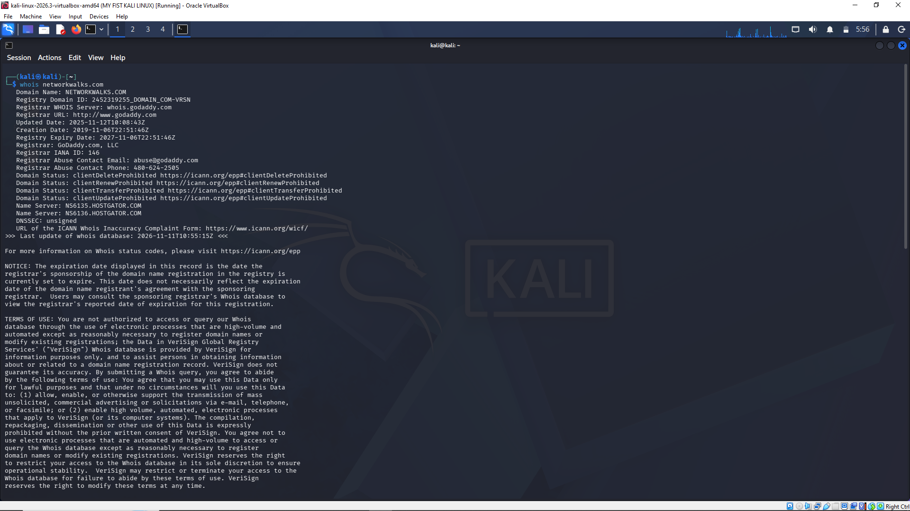

### WhatWeb
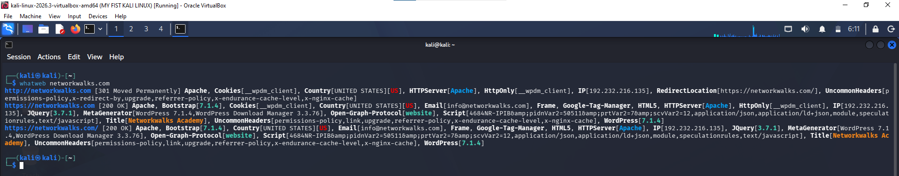

### Nslookup
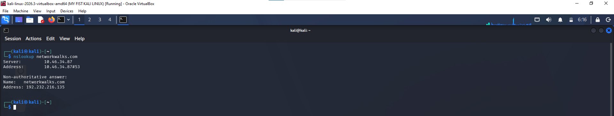

### cURL HTTP Headers
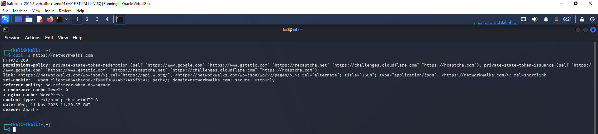

### WAFW00F
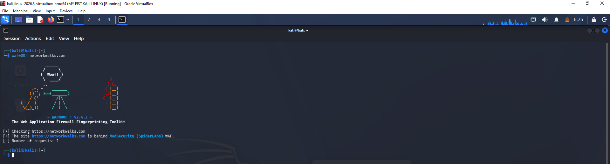

---

## GHDB

### Webcam Search Results
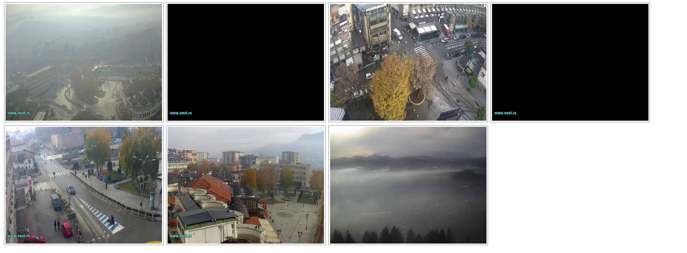

---

## Maltego

### Investigation Graph


### Transform Execution Output
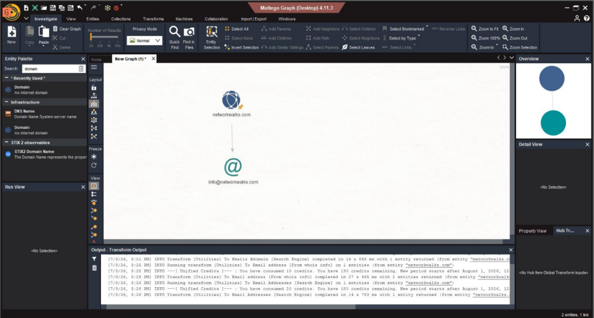

---

## TheHarvester

### Baidu Search Output
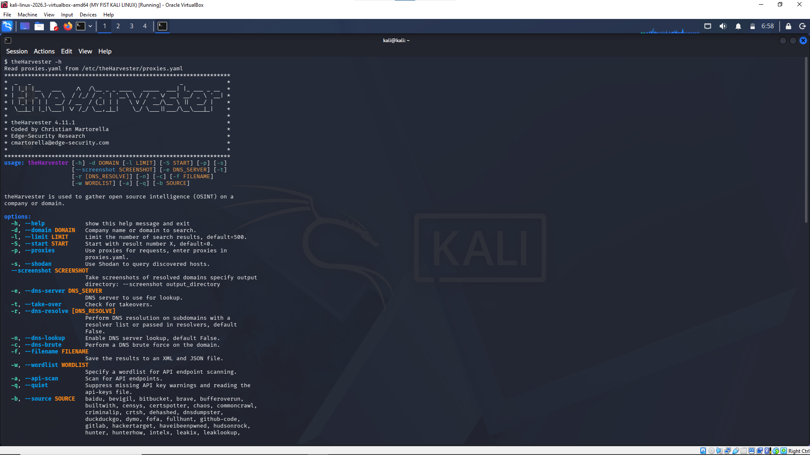

### All Sources Output
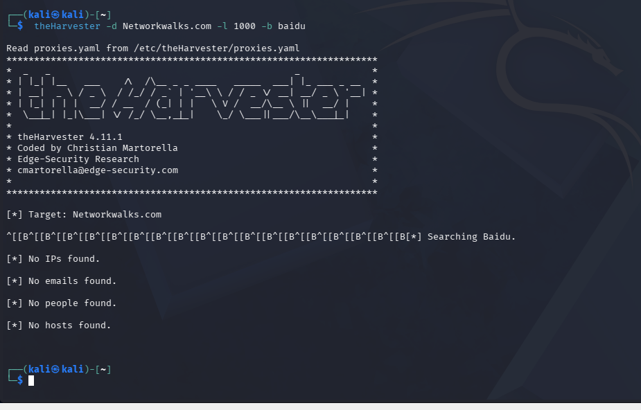

### Saved Results
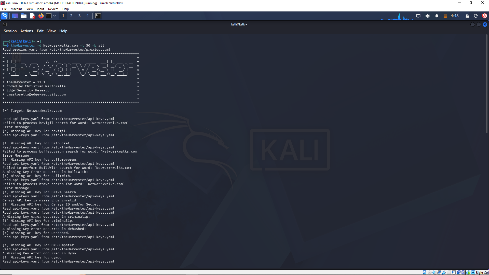

---

## Zenmap

### Network Topology
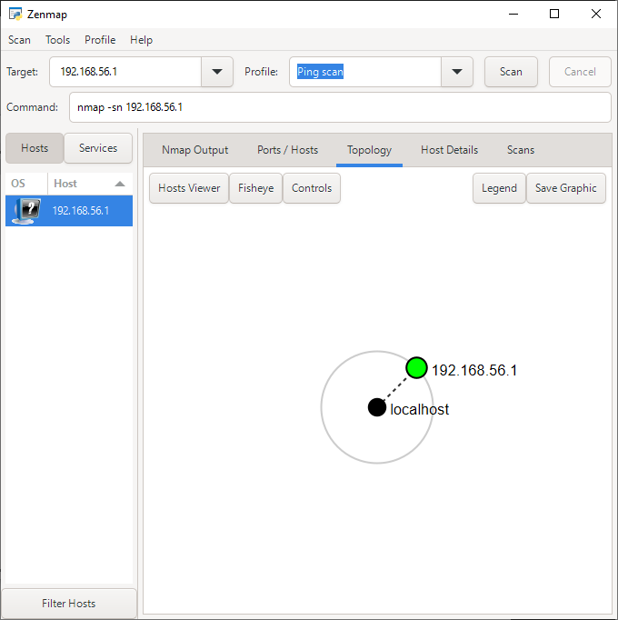

### Evidence Handling and Publication

Before publishing this report or its evidence to a public GitHub repository:

- Redact third-party camera IP addresses and sensitive endpoint details.
- Remove private network information that is not necessary to demonstrate the practical.
- Review raw theHarvester output for information that should not be publicly reproduced.
- Do not publish credentials, private interface paths or unnecessary personal information.
- Retain original screenshots and raw outputs privately where they are needed for assessment verification.
- Ensure that every evidence filename referenced in the report actually exists and corresponds to the activity described.

Maltego setup screenshots, including the download page, blank graph and practice graph using a different domain, should not be presented as findings from the actual investigation.


**END OF REPORT**

**Prepared by:** Nwadobu Chiemlie Fredrick\
**Internship:** Networkwalks Cybersecurity & Ethical Hacking\
**Batch:** B084\
**Date:** 13 November 2026


